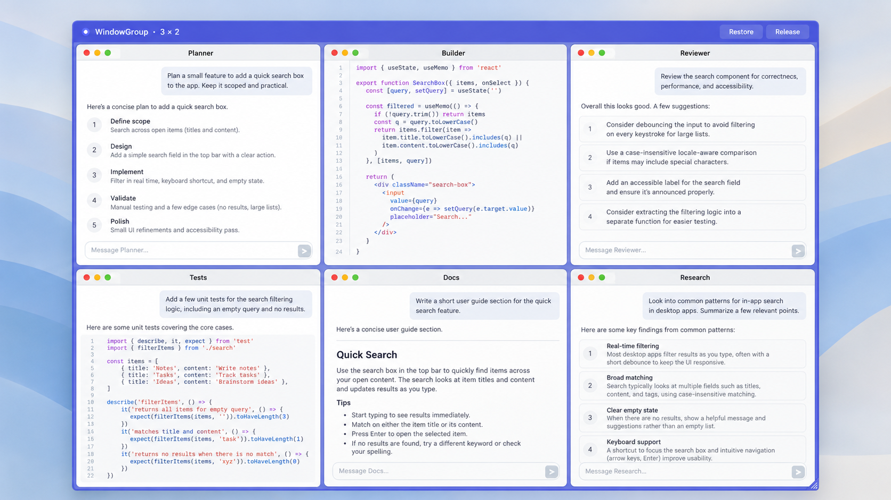
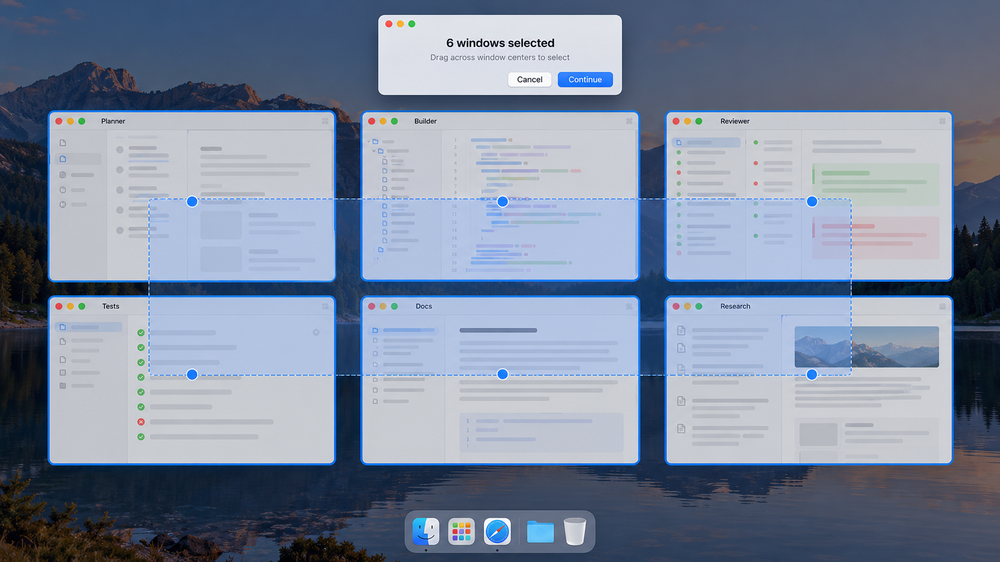

# WindowGroup

**Your agents are working in parallel. Your windows should, too.**

Running several AI coding agents at once changes how you work: one is building a feature, another is reviewing a change, and a third is waiting for your input. Keeping an eye on all of them shouldn't mean spending your day dragging windows back into place.

WindowGroup gives you a clear view of the work in flight. Select your existing windows, arrange them in an even grid, and move or resize the entire group as one. Keep your agents, editor, and reference windows together so you can see what's happening and jump in when you're needed.

**Select. Grid. Get back to building.**

[Get the early preview](https://github.com/drfraker/WindowGroup/releases/tag/v0.2.0) · [How to use it](#use-it) · [Build from source](#build)

> **Early preview:** The available Apple silicon build is signed for development and is **not notarized**. macOS Gatekeeper may block it on another Mac. The source can be built locally; a Developer ID–signed and notarized release is planned.

## See WindowGroup in action



*AI-generated illustration with fictional window contents.*



*AI-generated illustration of desktop selection; the actual interface may differ.*

## Use it

1. Open WindowGroup and grant it Accessibility access in System Settings.
2. Press **Control–Option–G** or choose **Select on Desktop**.
3. Drag a rectangle across the window center markers. Command-click to add or remove individual windows; Command-drag adds to the selection. Press Return or click Continue.
4. Choose a grid and display, then click **Arrange Windows**. For six windows, layouts include 3 × 2 and 2 × 3.
5. Drag the shared top bar to move the group, or its lower-right handle to resize it. **Restore** returns the original positions; **Release** leaves windows in place.

The checkbox picker remains available. Supports **1–12 windows**, with layout suggestions based on the selection count. Empty grid cells are labeled explicitly. Escape cancels selection. The shortcut uses a registered hotkey and does not require Input Monitoring access.

## Build

Requires macOS 13 or later and Xcode command line tools with Swift 5.9 or newer. There are no external package dependencies.

```sh
./build.sh
```

The script builds for the current Mac’s architecture and creates `WindowGroup.app` beside the repository directory. It signs locally with an ad hoc signature by default. `WINDOWGROUP_SIGN_IDENTITY` can select an existing signing identity. This does not notarize the app. The `WINDOWGROUP_BUILD_DIR` and `WINDOWGROUP_OUTPUT_DIR` variables override build and output paths.

## Current limitations

- One group, containing 1–12 ordinary resizable windows, on one desktop and destination display at a time. Native full-screen windows are excluded.
- Box selection includes windows whose center markers are inside the rectangle, including eligible windows behind other windows. Use Command-click or the list to refine the selection.
- Individual window moves are not tracked; the next group move or resize reapplies the grid. Group membership does not persist across app restarts.
- Apps can enforce minimum sizes, resize increments, or their own window placement. WindowGroup reports failures and attempts to restore prior frames.
- Accessibility access is required to list and control other apps’ windows. Window selection and layout data stay on the Mac; the app does not capture the screen.

## Testing

The project includes 21 unit tests for grid geometry, layout suggestions, and selection geometry. A separate disposable-window fixture supports Accessibility integration checks without moving other windows.

```sh
swift test
```

The macOS release distribution path requires a Developer ID Application signature, Hardened Runtime, a secure timestamp, and notarization. See [Apple’s notarization documentation](https://developer.apple.com/documentation/security/notarizing-macos-software-before-distribution).
